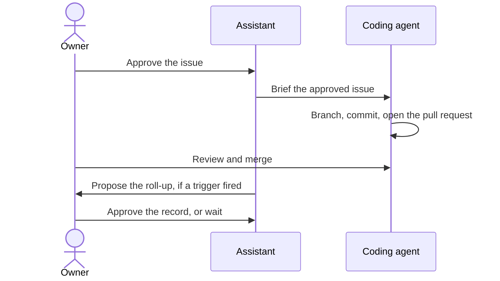
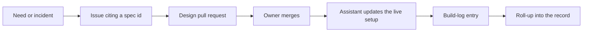
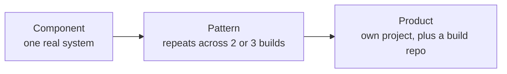

# Assistant Systems Design

A practice for building assistant systems, written down while the work is happening. Each build leaves a record: what it must do, what was decided, what is still ahead, and what the work taught. Those records are the raw material for a playbook, a course, or a client offering later. They are not reconstructed from memory after the fact.

Justin is the owner of this repository. The rules for who does what are in [AGENTS.md](AGENTS.md). The document model is in [STANDARD.md](STANDARD.md). Where this page and the standard differ, the standard is right.

This repository is public. It holds methods and decisions. It does not hold email addresses, secrets, or personal or client data.

## Projects

| Project | Folder | What it is |
| --- | --- | --- |
| Systems | [systems/](systems/) | Independent assistant-system case studies, not one product. First component: [justin-os](systems/justin-os/), documented and not validated. |

## Who does what

| Role | What they do |
| --- | --- |
| The owner | Approves issues, reviews, merges, and is the only one who approves a record. |
| The assistant | Scopes the work, drafts issues and specs, briefs the coding agent, and runs the roll-up conversation with the owner. |
| The coding agent | One job at a time, not a standing bot. Makes the commits, the branch, and the pull request for an approved issue. |

Every rule in [AGENTS.md](AGENTS.md) binds both the assistant and the coding agent. Draft-only sends bind the assistant. Branch and pull-request rules bind the coding agent.

One issue, in order:



## How the documents are organized

A project is a folder at the repo root. A component is a subfolder of a project. Every component has the same files from the day it is created.

| File | Its one job |
| --- | --- |
| `README.md` | Index, and the short public version of where things stand. |
| `brief.md` | Who it is for, the painful moment, what it replaces, what is out of scope. |
| `spec.md` | What it must do, with acceptance criteria. |
| `design.md` | How it works, and the decision log. Decisions are recorded once, here. |
| `plan.md` | Work still ahead. Milestones, each with an exit criterion. |
| `build-log.md` | What happened, and what each finding changed. Did, Broke, Learned. |
| `images/` | Drawings, replaced when the drawing changes. |

A project requires `README.md` and `brief.md`. Optional named types are `principles.md`, `product-spec.md`, and `architecture.md`. A collection of independent builds, such as [systems/](systems/), has no product spec and no architecture. Optional component types are `<slice>-design.md` and `<name>-prompt.md` only, added when a component needs one.

[`_template/`](_template/) is the standard as files: `project/`, `component/`, and `repo/`. Copy from there. Instructional placeholders stay in `_template/`. A live folder does not keep them.

## How work flows

Design leads. A change to what a system does is made in the design docs first. A code pull request cites that change. It does not edit the design.

1. **Issue.** An approved GitHub issue authorizes the work. Until then, GitHub is read-only. Read the issue first.
2. **Branch.** One issue, one branch, one pull request. The branch is `issue-<N>-<short-description>`. Never commit or push to `main`.
3. **Pull request.** The body says what changed and why, how each acceptance criterion was checked, and the checks that ran. **Decisions (proposed)** are the choices made inside the issue. **Build notes** are Did, Broke, and Learned. Merging approves those implementation choices only. A change to a requirement, the architecture, a security boundary, or documented behavior is a design change, made here first.
4. **Merge.** The owner reviews and merges. Nobody else merges.
5. **Roll-up.** The assistant asks when a pull request is merged, when an issue or milestone is done, and at the end of a working session with the owner if decisions are still unrecorded. On yes, a pull request in this repo proposes decisions for the component's `design.md`, findings for `build-log.md`, and lessons that generalize for the project's `principles.md`. Nothing enters the record until the owner approves it. On no, do not ask again until the next trigger.

`plan.md` holds milestones still ahead. A GitHub issue is one bounded piece of work inside a milestone, or a bug, or a small fix.

The same loop, when the change is to the design or to a live routine:



The design pull request carries the spec, the prompt, or the decision log, whichever changed. The roll-up writes decisions into `design.md`, findings into `build-log.md`, and lessons into `principles.md`. If those rows were already in the merged pull request, they are the roll-up.

## From one build to a product

One system is not a product yet. A pattern is, once it shows up again. A product is a pattern with its own spec and something that runs.



The component is one folder, such as [justin-os](systems/justin-os/). The pattern is what repeats, written in `principles.md` and copied forward from [`_template/`](_template/). The product is its own project, with `product-spec.md`, and a build repository for the running config. [systems/](systems/) is still at the first step. It is not a product.

## Checks

From the repo root:

```bash
python tools/validate.py
```

An error fails the check. Do not change an expected result to make it pass. The same command runs in the **Validate structure** workflow on every pull request and on every push to `main`.

## How records become IP

The brief, spec, decision log, plan, build log, principles, and prompt version log are the practice, stored where someone else can reuse them. A playbook, a course, or a client offering is assembled from those records. It is not a separate story written later. Client names and personal data never enter this repository, so the record can be shared.

## Starting a new system

`systems/` is the collection. A new system is a component inside it.

1. Copy [`_template/component/`](_template/component/) to `systems/<name>/`.
2. Fill the files. Remove the instructional lines. Say what is still open, and who decides.
3. Add a row to the components table in [systems/README.md](systems/README.md).
4. Open a pull request. The owner merges.

A new collection, if one is ever needed, is a copy of [`_template/project/`](_template/project/) at the repo root, plus a row in the projects table above. A future build repository starts from [`_template/repo/`](_template/repo/) and reads the design from here.

## Two examples

Both use real records already in [systems/justin-os/](systems/justin-os/). Neither example changes those files.

### Example A. Changing a live routine

This is how the loop works. The fix itself is proposed. It is not done.

The morning brief's first run, on 2026-11-25, skipped the Command Center refresh and still listed the website pilot. The pilot was paused on 2026-11-24 at 5:13 PM ET. Version 1 of [morning-brief-prompt.md](systems/justin-os/morning-brief-prompt.md) still describes the pilot as current work. The refresh is step 6 of that prompt. The requirement is JOS-ROUTINE-1 in [spec.md](systems/justin-os/spec.md).

1. **Issue.** Cite JOS-ROUTINE-1. Say the two misses: the refresh did not happen, and paused work was still listed. The issue is not opened by this page.
2. **Design pull request.** Add version 2 of the prompt, with a version-log line for the refresh and for dropping the current-pilot sentence. If that changes what the brief is allowed to say, add one row to the decision log in [design.md](systems/justin-os/design.md). Leave the spec alone unless the requirement itself changes.
3. **Owner merges.**
4. **Live setup.** In that same working session, the assistant updates the Grok Bot routine so it matches the merged prompt.
5. **Build log.** One entry, Did / Broke / Learned. Did: the prompt version and the routine. Broke: the first run skipped the refresh and still named the pilot. Learned: the first run is checked against the prompt's steps.
6. **Roll-up.** If the decision and the lesson were written in the pull request body instead of the files, a follow-up pull request puts them in `design.md`, `build-log.md`, and, if the lesson outgrows this component, `principles.md`. The owner approves that before it counts.

### Example B. Starting a new system

The folder below is a placeholder. Client names never go in this public repository. Do not create a folder whose name is a client.

1. Copy [`_template/component/`](_template/component/) to `systems/<client>-pm-assistant/`. Rename the placeholder before the pull request. A role is fine. A client name is not.
2. Fill `brief.md` first: the painful moment, what it replaces, and the measures.
3. Fill `spec.md` with requirement ids and a failure case on each.
4. Fill `design.md` with how it works and a decision log. Empty is allowed only when the log says no decision has been made yet, and who decides.
5. Add a row to the components table in [systems/README.md](systems/README.md). Do not link a folder that is not in the tree.
6. Run `python tools/validate.py` from the repo root. An error stops the pull request.
7. Open the pull request. The owner merges.

## This repo and the others

[STANDARD.md](STANDARD.md) forks [`justinyurasits/design` STANDARD.md](https://github.com/justinyurasits/design/blob/3d9b641237a3926149ad00c94f6343ce8b8e1a66/STANDARD.md) revision 61 (`3d9b641`). Product design stays in that repository. A change upstream is adopted here only on purpose, in a pull request that says what was taken and why.

No build repository exists yet. When one does, it will be a separate repo, started from `_template/repo/`, reading these docs from `../assistant-systems-design` or from a `DESIGN_DIR` override. It will not keep a second copy of the design.

## The files at the top

| File | Its one job |
| --- | --- |
| `README.md` | This page. |
| [STANDARD.md](STANDARD.md) | The document model. When this page and the standard differ, the standard is right. |
| [AGENTS.md](AGENTS.md) | Operating rules: roles, roll-up, and overrides. |
| [_template/](_template/) | The standard as files to copy. |
| [tools/validate.py](tools/validate.py) | The structure check. |
